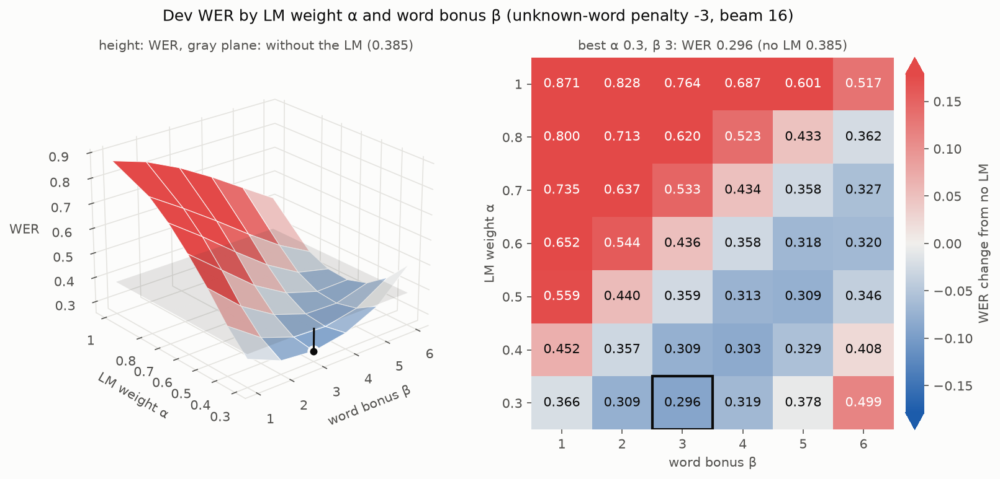

# speech

Speech is an open-source package to build end-to-end models for automatic
speech recognition. Sequence-to-sequence models with attention,
Connectionist Temporal Classification and the RNN Sequence Transducer
are currently supported.

The goal of this software is to facilitate research in end-to-end models for
speech recognition. The models are implemented in PyTorch.

The software requires Python 3.13 or later.

## Install

Install [uv](https://docs.astral.sh/uv/), then from the top level directory run:

```
uv sync
```

This creates a virtual environment with PyTorch and the other requirements and
installs the `speech` package into it. If you need a PyTorch build for a
specific CUDA version, see the
[uv PyTorch guide](https://docs.astral.sh/uv/guides/integration/pytorch/).

PyTorch and the other packages for training are in the `train` dependency
group, which `uv sync` installs by default. To only stream with exported
models, such as on a Raspberry Pi, see [Raspberry Pi](#raspberry-pi).

You can verify the install was successful by running the tests.

```
uv run pytest
```

## Run 

To train a model run
```
uv run train.py <path_to_config>
```

After the model is done training you can evaluate it with

```
uv run eval.py <path_to_model> <path_to_data_json>
```

To measure how fast a config trains on this machine, and how long an epoch
will take, before starting a long run:

```
uv run benchmark.py <path_to_config>
```

To see the available options for each script use `-h`: 

```
uv run {train, eval}.py -h
```

### Resuming training

After each epoch, `train.py` writes these files to the config's `save_path`:

| File | Contents |
|---|---|
| `model`, `preproc.pyc` | The model after the last epoch, for `eval.py` and `stream.py` |
| `best_model`, `best_preproc.pyc` | The model with the lowest dev CER so far |
| `train_state` | Everything needed to resume: the model, the optimizer state, the epoch and step counts, the best dev CER and the random number generator states |
| `events.out.tfevents.*` | The TensorBoard log |

Each file is written to a temporary file and then renamed, so stopping or
crashing during a save never leaves a broken checkpoint.

To continue a stopped run, give the same command with `--resume`:

```
uv run train.py <path_to_config> --resume
```

- Training continues after the last completed epoch. The progress of an
  unfinished epoch is lost.
- The saved preprocessor is reused. A new one would normalize the features
  with statistics from a different sample of the data.
- The TensorBoard log continues in the same run, and `best_model` is only
  replaced by a model with a lower dev CER than any before the stop.
- On the CPU a resumed run ends with exactly the same weights as a run that
  never stopped. On a GPU it continues the same way, but the weights can differ
  slightly, as GPU kernels can round differently.
- To train for longer than planned, raise `epochs` in the config and resume.
  Keep the rest of the config as it was, since the saved state belongs to that
  model and data.
- A run saved before resume support has no `train_state`. It resumes from its
  last `model` with a new optimizer state, which can make the loss jump for a
  while, and takes its completed epochs and best dev CER from the TensorBoard
  log.

### Data augmentation

Each of these keys in a config's `data` augments the training data, and
none is used for dev. They are applied in this order, each with a chance `p`
of 1 unless set. Each can also set `from_epoch`, the epoch, counted from 0,
from which it is applied, so the model can learn from clean audio before
noise is added:

| Key | What it does | Example |
|---|---|---|
| `noise` | Mixes random segments of recordings into the audio at a random signal-to-noise ratio in dB, keeping its peak. `source` is a directory of recordings or a dataset json, and `layers` mixes several, as babble from speech. A list adds several overlays. | `{"p" : 0.9, "source" : "examples/noise/data", "snr" : [8, 16]}` |
| `reverb` | Adds reverberation from five comb filters with a random delay in ms and decay per echo in dB, keeping the peak | `{"p" : 0.2, "delay" : [2, 18], "decay" : [0.55, 0.85]}` |
| `volume` | Sets the peak of the audio to a random level in dBFS, where 0 is full scale, clipping what exceeds it | `{"p" : 0.2, "dbfs" : [-13, 7]}` |
| `pitch` | Shifts the pitch by stretching the spectrogram's frequency axis by a random factor | `{"factor" : [0.9, 1.1]}` |
| `tempo` | Speeds speech up or down by stretching the spectrogram's time axis by a random factor, where above 1 is faster | `{"factor" : [0.9, 1.1]}` |
| `spec_augment` | Masks random frequency bands and time spans of the features ([SpecAugment]) | see `examples/commonvoice/ctc_streaming_3750h_gpu_config.json` |

The examples are the settings Mozilla's [DeepSpeech 0.9] trained with, and
the configs in `examples/commonvoice` use all of them, with babble from
LibriSpeech, but add noise to 30% of the clips instead of 90%, see its
README. Where these augmentations differ from DeepSpeech's:

- DeepSpeech measured the signal-to-noise ratio between peak levels, which
  gave louder noise for the same numbers than the power ratio here.
- Its volume range of -10 to 10 counts a full-scale peak as 3 dBFS, which is
  -13 to 7 here.
- It also added codec and bandwidth effects, which this repository does not
  have yet.

The reverb is DeepSpeech's, which colors the sound with the tones of its comb
filters. Recorded room impulse responses would sound more natural. For noise,
`examples/noise/download.py` downloads the background noise recordings of
Speech Commands, see `examples/noise/README.md`. The random choices come from
PyTorch's generator, so augmented runs resume exactly.

### Mixed precision and combined datasets

Set `"mixed_precision"` at the top level of a config to compute the network
in a lower precision, which GPUs run much faster:

- `"bf16"`, bfloat16, for NVIDIA A100, H100 and newer GPUs, and Apple silicon.
- `"fp16"`, float16, for older NVIDIA GPUs. float16 has a small range, so the
  gradients are scaled up, and the first few steps of a run can be skipped
  while the scale settles.

The losses are always computed in float32. On CUDA, the matrix products left
in float32 use TF32. On Apple silicon the RNNs stay in float32, since autocast
does not cover them there.

`train_set` and `dev_set` can be lists of dataset json files, to train on
several datasets at once, such as LibriSpeech and Common Voice in
`examples/commonvoice/ctc_streaming_3750h_gpu_config.json`.

### Learning rate schedules

Two keys in a config's `optimizer` lower the learning rate during training.
Both can be used together, and both continue after `--resume`:

| Key | What it does | Example |
|---|---|---|
| `lr_anneal` | Divides the learning rate by a constant factor after every epoch, as [Deep Speech 2] did with 1.2 | `"lr_anneal" : 1.2` |
| `lr_decay` | Multiplies the learning rate by `factor` when the dev loss has not improved for `patience` epochs, down to `min_lr` | `{"factor" : 0.5, "patience" : 1, "min_lr" : 1e-5}` |

The log shows the learning rate at the start of each epoch.

### Training deep models

Deep RNNs can stop learning early in training: the activations of the
convolutions grow until the gates of the GRU saturate, where their gradient
is almost zero. [Deep Speech 2] keeps them stable with batch normalization
and a curriculum, which these keys turn on:

| Key | Where | What it does |
|---|---|---|
| `"batch_norm" : true` | model `encoder` | Batch normalization after each convolution, per channel over all time steps, which replaces the convolution's bias, and sequence-wise on the input of each GRU layer, over all frames of all sequences in the batch. The statistics skip the padding. At inference the running averages from training are used, so streaming gives the same result as encoding the whole input. |
| `"relu_clip" : 20` | model `encoder` | The convolutions' ReLU clipped to `min(max(x, 0), 20)` |
| `"sortagrad" : true` | `data` | SortaGrad: the first epoch takes the batches in increasing order of their longest example, later epochs are random |
| `"accumulate" : 8` | `optimizer` | Averages the gradients of this many batches per optimizer step, a larger batch than fits in memory at once |
| `"grad_clip" : 400` | `optimizer` | Rescales the gradients to at most this norm, 200 by default |

Deep Speech 2 normalizes the input projection inside the recurrence instead
of the layer's input, which PyTorch's fused GRU does not allow. The first
3,750 hour run of `examples/commonvoice` trained without these keys and never
learned: after one epoch the inputs to its first GRU layer's gates averaged
178, against 0.04 at the start and 3 in the 100 hour model, 98% of the gates
were saturated, and its output no longer depended on the audio. The smaller
100 hour model trains without them.

Batch normalization does not reach the recurrence itself. At a learning rate
of 5e-4, which suits the 4×512 GRU of the 100 hour model, the recurrent
weights of the 5×1024 GRU grew until 20 to 46% of its gates saturated, and
its loss stopped falling after 200 steps. At 2e-4 fewer than 2% saturated
and it learned as fast as the smaller model. Adam moves every weight by about
the learning rate, so a layer with twice the inputs changes twice as fast,
and wider models need a lower rate.

Deep Speech 2 trained on batches of 512 utterances, rescaling gradients to a
norm of 400. With batches of 32 the 5×1024 model learned on LibriSpeech, but
not on the Common Voice mix in SortaGrad order: within 400 steps 35% of its
gates saturated and its CER on Common Voice stayed at 0.95. With 8 batches
of 32 accumulated into batches of 256 and a clip of 400, at most 5% of the
gates saturated. Batch normalization normalizes each batch of 32 on its own,
as before.

SortaGrad does not suit the Common Voice mix, though. Its shortest clips, of
two to four seconds, do not let a new model learn to read the audio, with
batches of 32 or of 256, and in the sorted order of 3,750 hours they fill
the first many hours of training. With batches of 256 the model only began
to learn once the clips reached about six seconds. In random order it
learned from the start, also with batches of 32: its CER on Common Voice
fell to 0.77 in 400 steps, against 0.95 in sorted order.

### Bigram outputs

A CTC model needs an output frame for each label, and one more between
two equal labels. The convolutions of the 3,750 hour configs stride 4 over
time, a frame every 40 ms, and English has so many characters per second
that a LibriSpeech dev-clean transcript of characters fills a median of 61%
of its frames, 77% at the 95th percentile. Tempo augmentation, which speeds
clips up by up to 10%, leaves some clips too few frames, and the loss
skips them. [Deep Speech 2] found the same: at a stride of 4 its WER was
26% worse than at a stride of 2 with characters, but as good with
non-overlapping bigrams.

Set `"bigrams" : true` in a config's `data` to train on bigrams, as
`examples/commonvoice/ctc_streaming_3750h_bigrams_config.json` does. Each
word is split into pairs of characters from its start, with the last
character of a word of odd length and each space on their own, so "the cat
sat" is th, e, space, ca, t, space, sa, t, see `speech/tokens.py`. That
fills a median of 38% of the frames of dev-clean and at most 65%, about
what characters fill at a stride of 2, without doubling the work of the
GRU.

- The labels are every character and every bigram of the training
  transcripts, 585 for `train-clean-100`. A word with a bigram that
  training never saw, such as in the dev set or a city name of an intent,
  is labeled by its characters.
- Decoded labels are characters again, so the CER and WER, the word LM,
  the intents, `stream.py` and the exported ONNX model work as for a model
  of characters.
- The intents' `THRESHOLD` is a mean log probability per label, and a
  sample has about half as many labels, so check it for a model of
  bigrams, and tune the LM again with `tune_lm.py`.

The beam search tries each label above the pruning threshold in a frame
for each prefix in the beam. With hundreds of labels an uncertain frame
can leave many above it, so it tries at most the 20 most likely, which
`--top-k` changes in `eval.py`, `stream.py` and `tune_lm.py`. On a
Raspberry Pi 4 at 1.0 GHz, the beam search with the LibriSpeech LM costs
about 0.01 s per second of audio for each label it tries per frame, so 20
labels bound it at about 0.2 s, with the model itself at about 0.3 s. For
the 3,750 hour model of characters, the limit changed none of the
transcripts of every fourth utterance of dev-clean with the LM.

## Streaming

A bidirectional encoder needs the whole utterance before it can output
anything. For streaming recognition, use a unidirectional RNN followed by a
lookahead convolution as in [Deep Speech 2]. Set `"bidirectional" : false` and
`"lookahead" : <frames>` in the model's `encoder` config. The lookahead is
counted in encoder frames, after the stride of the convolutional front end. For
example, with 10 ms input frames and a total stride of 2, a lookahead of 10 sees
200 ms of future audio. See `examples/timit/ctc_streaming_config.json`.

To encode audio as it arrives, call `model.encode_stream` with each chunk of
input frames and the state it returned on the previous call. Pass `final=True`
with the last chunk. The streamed outputs match `model.encode` on the full input.

To transcribe live from the microphone with a trained CTC model run

```
uv run stream.py <path_to_model> --mic
```

The model can also be a `.onnx` file from `export.py`, which runs without
PyTorch and several times faster, see [Raspberry Pi](#raspberry-pi).

The transcript grows as you speak, and a pause starts a new line. Stop with
Ctrl+C. Use `--mic-device` to pick a microphone from `uv run python -m
sounddevice`. Given audio files or a dataset json instead of `--mic`,
`stream.py` feeds the audio chunk by chunk and checks the result against
decoding the whole file at once.

### Browser demo

To try the models in a browser run

```
uv run serve.py
```

and open http://127.0.0.1:8000. The page lists the streaming CTC models
(directories with a `best_model`, and `.onnx` files from `export.py`) and
the LM `.npz` files under `examples`,
or under the directory given with `--models`. Click RECORD and speak, or pick
an audio file, which is streamed at real-time pace. The page sends 16 bit audio
to the server over a WebSocket and shows the transcript as it grows, with
finished lines listed below. Decoding runs on the CPU unless `--device` says
otherwise.

### Language model

CTC models can decode with a word n-gram language model, such as a 4-gram,
in the prefix beam search, both when streaming and in `eval.py`:

```
uv run stream.py <path_to_model> --mic --lm lm.npz
uv run eval.py <path_to_model> <path_to_data_json> --lm lm.npz
```

A word is scored once it is complete, as `lm_weight * log P(word | previous
words) + word_bonus`, plus `unk_penalty` for a word outside the LM's vocabulary.
While streaming, the transcript can change as more audio arrives, and a pause
scores the end of the sentence before starting a new line.

#### Training the language model

`speech.models.word_lm` trains an n-gram LM, a 4-gram by default or any
`--order` from 2, with interpolated modified Kneser-Ney smoothing, from
dataset json files or from text files with one sentence per line, which may
be gzipped. It writes the text as word ids to a temporary file and counts
each order in parts of it, each a pass over the file, so the corpus can be
far larger than memory: `--memory` sets the gigabytes to count in, 2 by
default, and less counts in more parts. The n-grams are stored as 64-bit
hashes. `--dev` reports the perplexity on a dev set, the lower the better.
LMs saved by the earlier bigram trainer, with interpolated absolute
discounting, load unchanged.

The transcripts of the training data make a small LM in about a second:

```
uv run python -m speech.models.word_lm examples/librispeech/data/train.json \
    examples/librispeech/models/lm-train.npz --dev examples/librispeech/data/dev.json
```

For a much larger LM, use the [LibriSpeech LM corpus], 800 million words of
normalized text from 14,500 public domain books:

```
curl -L -o examples/librispeech/data/librispeech-lm-norm.txt.gz \
    https://www.openslr.org/resources/11/librispeech-lm-norm.txt.gz
uv run python -m speech.models.word_lm \
    examples/librispeech/data/librispeech-lm-norm.txt.gz \
    examples/librispeech/models/lm-librispeech.npz \
    --order 2 --max-vocab 200000 --min-count 3 --dev examples/librispeech/data/dev.json
```

With the earlier bigram trainer this took 30 minutes and 2 GB of memory on an
8 GB MacBook Air, plus 3.5 GB of temporary disk space. It keeps the 200,000
most frequent words and the 9.9 million word pairs seen at least three times,
in a 171 MB file.

| LM | Text | Vocabulary | Dev perplexity |
|---|---|---|---|
| Training transcripts | 106 thousand words | 11,917 | 584 |
| LibriSpeech LM corpus | 844 million words | 200,003 | 270 |

`--min-count` drops the n-grams of each order, from bigrams up, seen fewer
times, such as `--min-count 2,2,2` for a 4-gram LM. Below the highest order
it counts the different words seen before an n-gram, as Kneser-Ney does.
Trained on the first 5 million sentences of the LibriSpeech LM corpus, 106
million words, with the 200,000 most frequent words and `--min-count 2` at
each order, on the 8 GB MacBook Air:

| Order | N-grams | File | Time | Memory | dev-clean perplexity | dev-clean WER |
|---|---|---|---|---|---|---|
| 2 | 3.7 million | 70 MB | 2 minutes | 2.4 GB | 388 | 0.363 |
| 3 | 11.6 million | 221 MB | 4 minutes | 2.4 GB | 286 | 0.354 |
| 4 | 17.7 million | 363 MB | 6 minutes | 3.2 GB | 269 | 0.353 |

The WER is of the 3,750 hour model after its second epoch, `eval.py` with a
beam of 32, weight 0.5 and bonus 4, which were also the best of a grid of 16
without an unknown-word penalty for the bigram and the 4-gram LM, on a
quarter of dev-clean.
Without an LM its WER is 0.427, and with the bigram LM of the whole corpus
0.343. The 4-gram LM lowers the perplexity by a third, but the WER by only
3%, as the acoustic model limits the result, see below. More text helped
more than higher orders here.

Best practices for the corpus:

- **Normalize the text like the transcripts.** Use the same characters as the
  acoustic model's labels, lowercase letters, the apostrophe and spaces here,
  with numbers and abbreviations spelled out and no punctuation. The trainer
  lowercases, but a word with other characters can never be decoded and only
  takes probability from the others. The LibriSpeech LM corpus is already
  normalized this way.
- **One sentence per line.** The LM learns how sentences start and end from
  the line breaks, and the decoder scores the end of a sentence at each pause.
- **Keep evaluation text out.** Text from the dev or test sets, even other
  sentences from the same books, which share names and phrasing, makes the
  LM look better than it is. The LibriSpeech LM corpus leaves out the books
  of its dev and test sets.
- **Match the domain.** Text like what will be said matters more than its
  amount. Nineteenth century books suit LibriSpeech but not someone talking
  into a microphone, so add text from your domain when you have it.
- **Bound the size.** `--max-vocab` keeps the most frequent words and
  `--min-count` drops rare word pairs, to keep the model small and fast to
  load. Check the effect on the dev perplexity and WER.
- **Retune the decoder after any change** to the LM or the acoustic model,
  as described next. The best weights depend on both.

#### Tuning the weight, bonus and unknown-word penalty

The LM weight α sets how much the LM counts against the acoustic model, the
word bonus β offsets the LM's preference for fewer, longer words, and the
unknown-word penalty decides how strongly to push misspelled or unknown words
towards words the LM knows. `tune_lm.py` grid searches them on a dev set. It
runs the acoustic model once and then decodes the dev set for each setting in
parallel, ranking the settings by WER:

```
awk 'NR % 4 == 1' examples/librispeech/data/LibriSpeech/dev-clean.json > dev-clean-quarter.json
uv run tune_lm.py examples/commonvoice/models/ctc_streaming_3750h_epoch2 \
    dev-clean-quarter.json --lm examples/librispeech/models/lm-librispeech.npz \
    --weights 0.3,0.4,0.5,0.6,0.7,0.8,1.0 --bonuses 1,2,3,4,5,6 \
    --unk-penalties=0,-3 --results docs/lm-tuning.json --plot docs/lm-tuning.png
```

Values that start with a minus need the equals sign. It tunes with a beam of
16 to save time. A wider beam then adds a little on top. With
`--from-results` it reports and plots saved results again.

<picture>
  <source media="(prefers-color-scheme: dark)" srcset="docs/lm-tuning-dark.png">
  
</picture>

The plot shows the dev WER over α and β at the best unknown-word penalty, with
blue for settings better than decoding without the LM and red for worse ones,
for the LibriSpeech bigram LM and the 3,750 hour model after its third epoch,
on every fourth utterance of dev-clean, 676 of them:

- The good settings form a diagonal valley. A stronger LM needs a larger word
  bonus, or it drops and merges words, and too large a bonus inserts words.
- An unknown-word penalty now helps. Without one the best setting, α 0.4 and
  β 3, was hardly better than α 0.5 and β 4. A finer grid around the best
  found a flat floor from α 0.25 to 0.35, β 2.5 to 3 and a penalty of -2 to
  -3, while -4 was worse and -6 clearly worse. Most of this model's
  misspelled words are close to a word the LM knows, which the penalty
  pushes them to.
- The best setting, α 0.3, β 2.5 and a penalty of -2, became the default. On
  all of dev-clean with a beam of 32 it lowered the WER from 0.388 without
  the LM to 0.286, against 0.313 at α 0.5 and β 4, and the CER from 0.128 to
  0.110.

For the 100 hour model, with a CER of 0.3, the best setting was α 0.5, β 4
and no penalty, the default before, and a negative penalty only made things
worse: most of its words had a wrong letter, too far from any word to push
to the right one. The LM lowered its dev WER, of the 10 hour configs' dev
set, from 0.787 to 0.687, 13%, against 26% for the 3,750 hour model. The
small LM from the training transcripts did as well for it, WER 0.685, as the
acoustic model limited the result.

[LibriSpeech LM corpus]: https://www.openslr.org/11/

[Deep Speech 2]: https://arxiv.org/abs/1512.02595
[DeepSpeech 0.9]: https://github.com/mozilla/DeepSpeech/releases/tag/v0.9.0
[SpecAugment]: https://arxiv.org/abs/1904.08779

## Raspberry Pi

A streaming CTC model exported to ONNX runs with [ONNX Runtime] and NumPy,
without PyTorch, which suits small devices such as a Raspberry Pi 4. Export
the model on the machine it was trained on:

```
uv run export.py examples/librispeech/models/ctc_streaming_100h
```

This writes `best_model-int8.onnx` to the model's directory, a single file
with the weights, the feature normalization and the labels. It then streams
random input through the file and prints the largest difference of its
output probabilities from the PyTorch model's. `--last` exports the last
model instead of the best one.

The GRU weights, nearly all of the model and of the memory read for each
frame, are stored as 8 bit integers, which makes the file four times
smaller and the model faster where memory is slow, as on a Pi. `--fp32`
keeps them in float32, which gives the PyTorch model's output: on the
LibriSpeech dev-clean set every transcript was the same. int8 hardly
changes the accuracy there, and the LM settings tuned with `tune_lm.py`
apply unchanged:

| 100 hour model | CER | WER | CER with LM | WER with LM |
|---|---|---|---|---|
| PyTorch | 0.208 | 0.577 | 0.190 | 0.480 |
| ONNX, int8 | 0.208 | 0.579 | 0.190 | 0.481 |

Each frame's input to the GRU is quantized with its own scale, so how the
audio is split into chunks hardly matters: streaming 100 ms chunks changed
the CER by less than 0.001 against decoding each file whole.

`stream.py`, `serve.py` and `eval.py` take the `.onnx` file in place of the
model directory:

```
uv run stream.py examples/librispeech/models/ctc_streaming_100h/best_model-int8.onnx --mic
```

On an M1 MacBook Air, the compute per second of audio streamed in 100 ms
chunks, with 4 threads:

| | 100 hour model, 4×512 | 3,750 hour model, 5×1024 |
|---|---|---|
| PyTorch, greedy | 0.040 s | 0.118 s |
| ONNX int8, greedy | 0.012 s | 0.022 s |
| ONNX int8, LibriSpeech LM | 0.026 s | 0.045 s |

PyTorch was fastest with one thread, the numbers above. These were not
measured on a Pi. A Pi 4's cores are several times slower than the M1's
and its memory far slower, so expect several times these numbers there.
To measure on the Pi, stream a few files of a dataset and read the compute
per second of audio:

```
uv run --no-default-groups stream.py model.onnx dev.json --num 5
```

### Setting up the Pi

1. Install the 64-bit Raspberry Pi OS, Bookworm or later. The 32-bit one
   has no ONNX Runtime packages.
2. Install PortAudio for the microphone, and uv:
   ```
   sudo apt install libportaudio2
   curl -LsSf https://astral.sh/uv/install.sh | sh
   ```
3. Clone this repository, and install only what streaming needs, without
   PyTorch:
   ```
   uv sync --no-default-groups
   ```
4. Copy the exported model, and an LM if you want one, from the training
   machine, such as with `scp`.
5. Run the scripts with `--no-default-groups`, or uv installs the training
   packages for them:
   ```
   uv run --no-default-groups stream.py best_model-int8.onnx --mic --lm lm.npz
   ```

Tips:

- **Threads.** The model uses one thread per core by default, which sleep
  between chunks rather than spin, so the beam search keeps a core and the
  Pi stays cooler. `--threads` sets the number.
- **Memory.** Streaming takes about 140 MB, 290 MB with the 200,000 word
  LibriSpeech LM. The LM from the training transcripts did as well on
  LibriSpeech, see [Language model](#language-model), and is 100 times
  smaller.
- **Cooling.** A Pi 4 slows down when it gets hot, so use a heatsink or a
  fan for long sessions.
- **Browser demo.** `serve.py --host 0.0.0.0 --models <dir>` serves the
  page to other devices, but browsers only allow the microphone on
  `localhost` or over HTTPS, so from another device only audio files work.

### Speech recognizer service

`backend.py` runs the recognizer as a service with an HTTP API, for a head
unit or another client to start and stop captures and show the transcript
and display cards it sends:

```
uv run --no-default-groups backend.py best_model-int8.onnx --lm lm.npz --host 0.0.0.0
```

It listens to the Pi's microphone, or with `--audio-input client` to
audio the client streams. It recognizes intents in what is said, such as
"what's the weather in hamburg?", and shows the answer, a card with the
weather, and asked to "play superball", it starts a game steered by
saying "left" and "right".
At http://127.0.0.1:8080 it serves a client with a landing page and a
microphone button. See [docs/backend-api.md](docs/backend-api.md) for the
API, and `deploy/speech-backend.service` to start it with the Pi.

[ONNX Runtime]: https://onnxruntime.ai

## Examples

For examples of model configurations and datasets, visit the examples
directory. Each example dataset should have instructions and/or scripts for
downloading and preparing the data. There should also be one or more model
configurations available. The results for each configuration will be documented
in each example's `README.md`.

- `examples/librispeech`: read audiobooks. The streaming CTC model, the
  language model and the decoding described above were tuned on it. Its
  `README.md` has the recipe and the results, a test-clean WER of 0.470 for
  the streaming CTC model trained on 100 hours.
- `examples/commonvoice`: [Mozilla Common Voice], crowd-sourced read speech
  with many speakers, accents and microphones, for training with LibriSpeech
  on a GPU.
- `examples/speech_commands`: Speech Commands, single words such as "left"
  and "right" said alone, which the Common Voice configs also train on, and
  an evaluation of how a model recognizes them.
- `examples/timit` and `examples/wsj`: the original examples of this
  repository.

[Mozilla Common Voice]: https://commonvoice.mozilla.org
